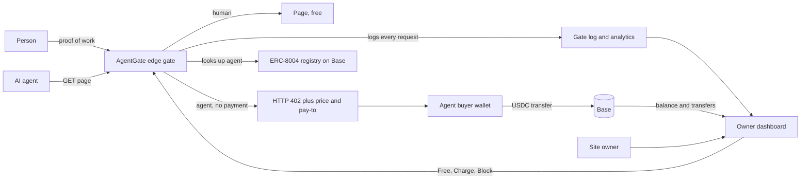
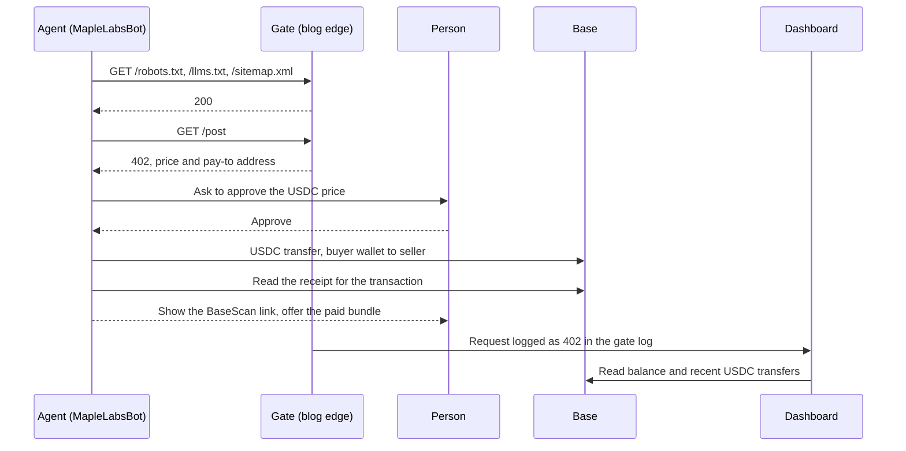
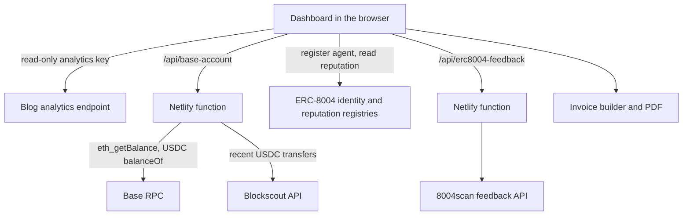

# AgentGate (Colosseum edition)

AgentGate lets a site owner charge AI agents for reading their content, instead of hoping they honor `robots.txt`.
An unpaid agent gets an HTTP 402 with a price. A paying agent gets the page and a receipt. The owner sees who read
what, what they paid, and what was blocked.

This edition settles in **USDC on Base** (Base Sepolia by default, Base mainnet with one env var). Agent identity comes
from the ERC-8004 identity registry on Base.

- Dashboard: https://monetize-your-data-from-agents-colosseum.netlify.app
- Crawl Sandbox (demo bot): https://agent-preview-colosseum.netlify.app
- Gated demo blog: https://dheeraj-work.netlify.app ([`robots.txt`](https://dheeraj-work.netlify.app/robots.txt), [`llms.txt`](https://dheeraj-work.netlify.app/llms.txt))

This is the Base port of [dhru7777/AgentGate](https://github.com/dhru7777/AgentGate), which settles on Monad testnet.

## The problem

AI agents now read the open web at scale. A site owner has two options today, and both are bad:

1. **Block them in `robots.txt`.** It is a request, not a lock. Nothing enforces it, and owners cannot even see which agents ignored it.
2. **Let them read for free.** The owner pays the hosting bill and gets no revenue and no record of who took what.

Existing 402 paywalls can say that someone paid. They cannot say which agent paid, for what, or under which policy.

## How we approach it

AgentGate gives owners a third option: **charge them**.

- **Charge agents, not people.** The gate only prices clients that identify as agents. People keep reading for free and pass a small proof-of-work check instead.
- **Pay per page, in USDC on Base.** An unpaid agent gets HTTP 402 with a price and a pay-to address. Cent-level prices work because Base fees are a fraction of a cent.
- **Tie identity, price, payment and receipt together.** Agents are looked up in the ERC-8004 identity registry, so a registered agent can be priced differently from an anonymous one.
- **Know who the agent is.** Agents have an ERC-8004 identity in the public registry on Base. [8004scan](https://testnet.8004scan.io) shows each agent's profile and the feedback sites have left about it.
- **Show the owner everything.** The dashboard lists agents that stop at the 402, agents that ignore it, and agents that pay, with a BaseScan link for every transfer.
- **Safe by default.** Everything runs on Base Sepolia with testnet USDC unless you set `VITE_BASE_NETWORK=mainnet`.

## Architecture

The loop in one picture: a request becomes a paid read only after the gate has priced it and the payment has settled on Base.



### What happens on one paid read



In this edition the training bundle is built from a local snapshot (`apps/maplelabs-bot/data/snapshot.json`), so paying
shows the full settlement without unlocking the live blog.

### Dashboard data flow



### Gate decisions

| Client | Policy | Result |
|---|---|---|
| Person | any | Proof-of-work check, then the page for free |
| Agent | Free | Page, logged as free |
| Agent | Charge | HTTP 402 until paid, then page with a receipt |
| Agent | Block | Stopped, logged as blocked |
| Agent that ignores the 402 | Charge | Never gets the page, shown as a bad agent |

## What is in the repo

| Path | What it is |
|---|---|
| `apps/dashboard` | Owner dashboard: services, per-agent rules (Free, Charge, Block), live analytics, wallet, ERC-8004 identity, invoices |
| `apps/maplelabs-bot` | MapleLabsBot, a test crawler with Search and Train modes. It hits a gated blog, reads the 402, and pays from a buyer wallet after you click Approve |

## Run it

```bash
# dashboard
cd apps/dashboard && npm install && npm run dev      # http://localhost:5173

# demo crawler
cd apps/maplelabs-bot && node server.mjs             # http://localhost:5180
```

Test the crawler without touching the real blog or moving money: `cd apps/maplelabs-bot && npm test`. It starts a fake
blog on localhost and finishes in a couple of seconds. Run `npm install` once inside `apps/maplelabs-bot/wallet/` before using Approve.

## Configuration

Everything has a safe default (Base Sepolia, no real money). Override with env vars.

Dashboard (`apps/dashboard/.env.local`):

| Variable | Purpose |
|---|---|
| `VITE_BASE_NETWORK` | `mainnet` to use Base mainnet. Default is Base Sepolia |
| `VITE_BASE_RPC_URL` | Custom Base RPC |
| `VITE_RECEIVE_ADDRESS` | Address that receives USDC |
| `VITE_IDENTITY_REGISTRY`, `VITE_REPUTATION_REGISTRY` | ERC-8004 registries. The defaults are live on Base Sepolia. Set both for mainnet |
| `VITE_INVOICE_AGENT_ID` | Your ERC-8004 agent id on Base. Register it from the Identity tab, then set this. Until then no agent is shown as verified |
| `VITE_BLOG_ANALYTICS_KEY` | Key for the blog analytics endpoint |
| `BLOCKSCOUT_API_KEY` | Optional, server side. Lifts the explorer rate limit for recent transfers |

Demo crawler (`apps/maplelabs-bot/.env.local`, gitignored):

| Variable | Purpose |
|---|---|
| `BUYER_WALLET_PRIVATE_KEY`, `BUYER_WALLET_ADDRESS` | Wallet that pays after you click Approve. The key never leaves the server. Leave unset on a public deploy |
| `SELLER_WALLET_ADDRESS` | Receives the USDC |
| `BASE_NETWORK`, `BASE_RPC_URL` | Network and RPC. Default Base Sepolia |
| `BLOCKSCOUT_API_KEY` | Optional. Free key from dev.blockscout.com. Stops the explorer rate limit that empties "Last 3 transfers" |
| `ANALYTICS_KEY` | Read-only access to the blog's analytics, for the globe and the gate log. It cannot change the paywall |
| `ADMIN_KEY` | Optional. Only needed to switch Free, Charge or Block from the preview |
| `SITE`, `PORT` | Blog to crawl (default `https://dheeraj-work.netlify.app`) and local port (default `5180`) |
| `ANTHROPIC_API_KEY`, `OPENAI_API_KEY` | Optional brains for the bot |

See `apps/maplelabs-bot/README.md` for modes, brains and the payment caps.

## How a paid read works

1. An agent requests a gated post and gets HTTP 402 with the price and the pay-to address.
2. After a person clicks Approve, the buyer wallet sends USDC to the seller on Base. Each click is capped at 1 USDC and the recipient is always the seller.
3. The bot confirms the transaction receipt on Base and offers the paid bundle.
4. The dashboard shows the agent, the amount and a BaseScan link.

## Pre-existing work

- The Netlify blog gate (a proof-of-work check for people, HTTP 402 for agents) at `dheeraj-work.netlify.app` existed before this edition.
- This repository is the Base port of [dhru7777/AgentGate](https://github.com/dhru7777/AgentGate). The dashboard and MapleLabsBot started from that code. Chain, wallet, ERC-8004 and settlement code was moved from Monad to Base. Monad-specific pieces (the Mera passkey wallet) are not part of this edition.
- The first commit in this repository is dated 2026-10-01.

## AI tool disclosure

Built with Claude Code (Anthropic) for drafting and refactoring, reviewed by the team. MapleLabsBot can use Claude
(Anthropic Messages API) or OpenAI as its brain. Payments in the demo are real testnet transfers, sent only after a
person clicks Approve.
